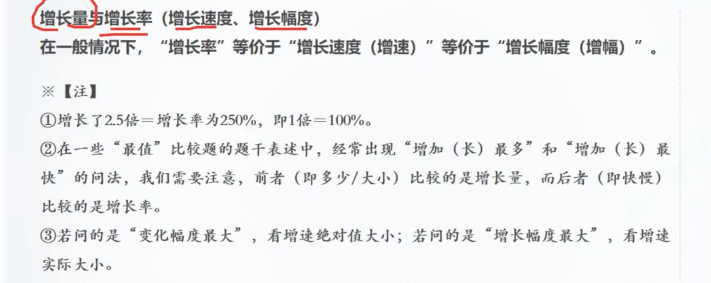
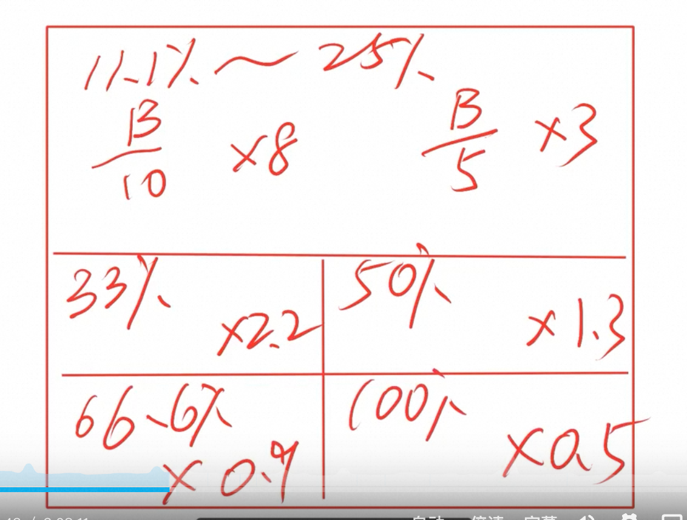
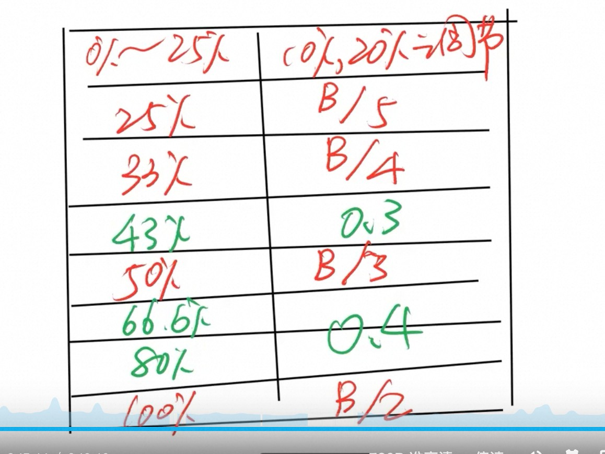
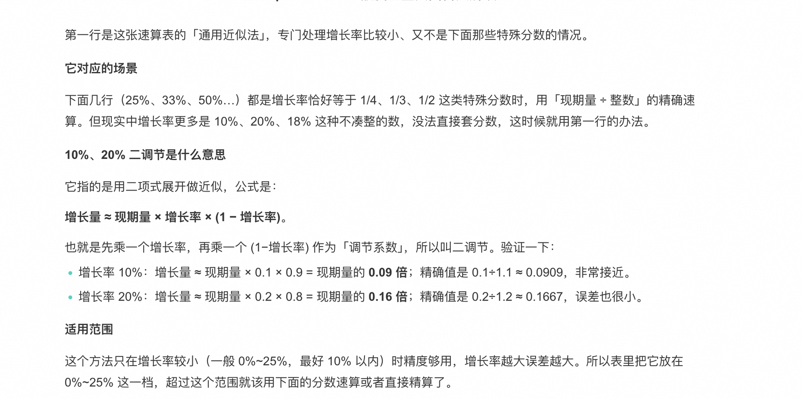
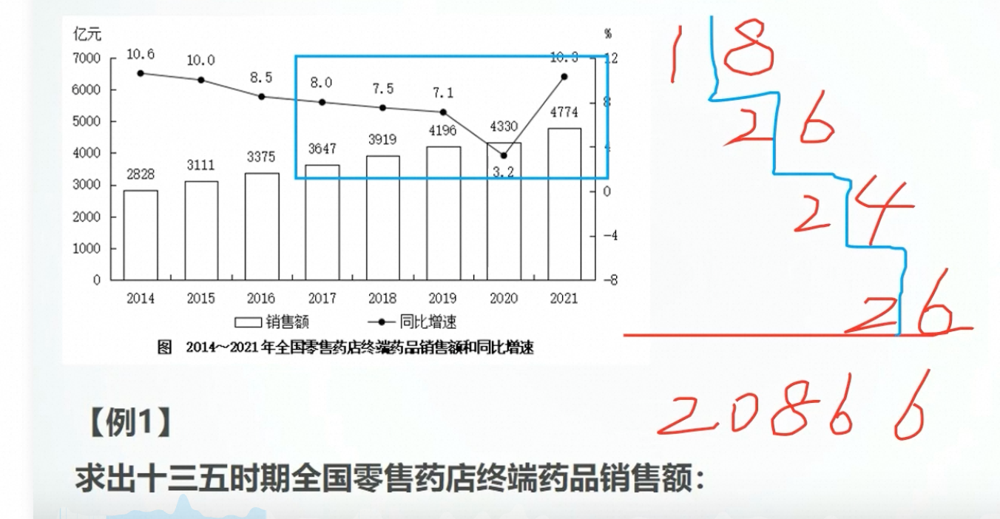

---
nav:
  title: 考公
  order: 4
group: 常用公式
order: 1
toc: content
title: 资料分析
---

# 资料分析

>
> 术语对照：**现数 = 现期量**（较晚时期的数），**基数 = 基期量**（作为比较基准的数）。

## 一、量与量之间的关系（一切公式的地基）

资料分析所有公式，都是从"现数与基数的关系"推出来的。

### 1.1 绝对关系 → 增长量

用**减法**，结果**带单位**（人、元、吨）：

```text
现数 - 基数 = 增长量
```

### 1.2 相对关系 → 倍数、增长率

用**除法**，结果**没有单位**：

```text
① 倍数   = 现数 / 基数
② 增长率 = (现数 - 基数) / 基数 = 现/基 - 1
```

记忆技巧：增长率就是"倍数再减 1"，见 1.3。

### 1.3 黄金恒等式（必背）

```text
增长率 + 1 = 倍数
```

增长率与倍数的相互转换全靠它："增长了 20%" 等价于 "是去年的 1.2 倍"。

### 1.4 一道题验证全懂

2024 年产值 120 亿，2023 年（基期）100 亿：

```text
增长量 = 120 - 100 = 20 亿        （绝对关系，减法）
倍数   = 120 / 100 = 1.2 倍       （相对关系，除法）
增长率 = 20 / 100 = 20% = 1.2 - 1 （两种算法互相验证）
```

### 1.5 增长量与增长率的题干辨析

一般情况下，**"增长率"等价于"增长速度（增速）"，等价于"增长幅度（增幅）"**——三个词是同一个东西。真正要防的是题干里这几组"长得像"的问法：

```text
① 增长了 2.5 倍 = 增长率为 250%，即 1 倍 = 100%
   （倍数与增长率互转仍是靠 1.3 的黄金恒等式，"增长了"才减 1，"是……的"不减）

② "增加（长）最多" → 比增长量（问多少/大小）
   "增加（长）最快" → 比增长率（问快慢）
   最值比较题里这是命题人最爱挖的坑，先看问"多"还是问"快"再动笔

③ "变化幅度最大" → 看增速的绝对值大小（降幅 -8% 也算幅度 8%）
   "增长幅度最大" → 看增速的实际大小（负增长直接出局）
```



**例**：四个地区增速分别为 10%、5%、-8%、7%：

```text
问"增长最快"       → 10%
问"变化幅度最大"   → -8%（绝对值 8% 最大，降也是"变化"）
问"增长幅度/增幅最大" → 10%（-8% 是下降，不参与比增幅）
```

## 二、四大核心量互推

设 r = 增长率。考试本质：已知任意两个量，求第三个。

| 已知 | 求 | 公式 |
|---|---|---|
| 基期量、r | 现期量 | 现期量 = 基期量 × (1+r) |
| 现期量、r | 基期量 | 基期量 = 现期量 ÷ (1+r) |
| 现期量、r | 增长量 | 增长量 = 现期量 × r/(1+r) |
| 现期量、基期量 | r | r = (现-基) ÷ 基 |

最常考的是中间两行：**“给现期和增长率，求基期/增长量”**。

增长量公式的速算思路：把 r/(1+r) 换成特殊分数（见第四节）。

**例**：2024 年某地社会消费品零售总额 480 亿元，同比增长 20%，求基期量与增长量：

```text
基期量 = 480 ÷ (1+20%) = 480 × 5/6 = 400 亿元
增长量 = 480 × 20%/120% = 480 × 1/6 = 80 亿元
```

（20% → 1/5，1/(1+r) = 5/6，r/(1+r) = 1/6，全是特殊分数化简，免大数除法）

## 三、常见拓展概念

### 3.1 隔年（间隔）增长率

已知 2024 年比 2023 年增长 r1，2023 年比 2022 年增长 r2，求 2024 比 2022：

```text
r隔 = r1 + r2 + r1 × r2
```

**例**：2023 年某省固定资产投资比上年增长 10%，2024 年比上年增长 15%，求 2024 年比 2022 年增长百分之几。

```text
r隔 = 15% + 10% + 15%×10% = 25% + 1.5% = 26.5%
```

用具体量验证：设 2022 年为 100，则 2023 年 = 100×1.10 = 110，2024 年 = 110×1.15 = 126.5，增长率 26.5% ✓。不能直接 15%+10%=25%：2024 年的 15% 是在变大后的基数上增长的，多出的 1.5% 正是交叉项（复利部分）。

**真题常见给法**：不说两个增速，而说"2024 年比上年增长 8%，增速比上年提高 3 个百分点"。先还原 2023 年增速 = 8% − 3% = 5%，再套公式：

```text
r隔 = 8% + 5% + 8%×5% = 13% + 0.4% = 13.4%
```

速算：交叉项 = 去掉百分号相乘 ÷ 100（15×10÷100 = 1.5）；两个增速均小于 10% 时交叉项不足 1%，可先相加再修正。

### 3.2 连续增长率

间隔增长率是"两期连乘"的特例。连续增长 n 期、每期增长率分别为 r1、r2、…、rn 时，**不能直接相加，必须连乘**：

```text
总增长率 = (1+r1) × (1+r2) × ... × (1+rn) - 1
现期量 = 基期量 × (1+r1) × (1+r2) × ... × (1+rn)
```

n = 2 时展开就回到间隔增长率：(1+r1)(1+r2) - 1 = r1 + r2 + r1×r2。

若每期增长率相同（连续 n 期均增长 r）：

```text
总增长率 = (1+r)^n - 1
现期量 = 基期量 × (1+r)^n
```

**例**：每年增长 10%，连续增长两年，总增长率 = 1.1² - 1 = 21%，不是 20%（多出的 1% 正是 r1×r2 复利项）；连续三年 = 1.1³ - 1 = 33.1%。

### 3.3 年均增长率

连续增长率的反向：已知首尾两期，反求平均每期涨多少。**本质是几何平均，不是把增长率相加除以 n**。

**标准公式**：

```text
(1 + r均)^n = 现期量 / 基期量
r均 = (现期量/基期量)^(1/n) - 1
```

**第一步先定 n（最高频的坑）**：n = 现期 − 基期（年份差），不是年份个数。

```text
"2021—2024 年均增长率"：基期 2020（材料会给出 2020 年值），n = 2024 - 2020 = 4
```

**第二步估 r（开方算不了，用居中代入法）**：把选项居中的 r 代入 (1+r)^n，与 现期量/基期量 比大小，偏大往小调、偏小往大调，二分排除。(1+r)^n 随 r 单调递增，方向不会错。

**完整例题**：2020 年产值 100 亿，2024 年 146 亿，求年均增长率。

```text
① 定 n：2024 - 2020 = 4
② 定倍数：146 / 100 = 1.46
③ 试 r = 10%：1.1⁴ = 1.4641 ≈ 1.46 ✓
④ r均 ≈ 10%
```

**粗估（只用于没选项快速估）**：

```text
r均 ≈ 总增长率 / n    （结果略偏大，因为忽略了复利）
```

**粗估例**（2020 年 100 亿 → 2024 年 146.41 亿）：

```text
总增长率 = 46.41%，n = 4
粗估 r均 ≈ 46.41% ÷ 4 = 11.6%
真实 r均 = 1.4641^(1/4) - 1 = 10%      （1.1⁴ = 1.4641）
多出的 1.6% 正是复利项被摊进每年：6.41% ÷ 4 ≈ 1.6%
```

**修正幅度经验表**（n = 4）：

| 总增长率 | 粗估值 | 真实值 | 偏差（个百分点） |
|---|---|---|---|
| 20% | 5% | 约 4.7% | 0.3，基本不用修 |
| 46.41% | 11.6% | 10% | 1.6，往小修一档 |
| 100% | 25% | 约 18.9% | 6，大幅下修 |

口诀：增长率小（30% 以内）粗估值就是答案；增长率越大、n 越大，往下修得越多。

**易错点**：

- r均 略小于 总增长率/n：用除法粗估的结果偏大，是上界，选答案往小档修正
- 各年增长率不同时，r均 ≠ 各年增长率的算术平均；(1+r均)^n 只保证首尾两端相等

### 3.4 乘积增长率

当某个量是两个量的**乘积**（总量 = A × B）时，总量的增长率不是两个增长率简单相加：

```text
总量 = A × B
r总 = rA + rB + rA × rB
```

推导与 3.1 同源：总量现期 = A(1+rA) × B(1+rB)，故 r总 = (1+rA)(1+rB) - 1，展开即上式。间隔增长率是"同一个量连乘两期"，乘积增长率是"两个量各乘各的"，数学结构完全一样。

典型场景：

- 总产量 = 亩产 × 种植面积
- 销售额 = 单价 × 销量
- 总产值 = 人均产值 × 从业人数

**例**：种植面积增长 10%，亩产增长 20%，总产量增长率 = 10% + 20% + 10%×20% = 32%，不是 30%。

速算：rA、rB 都小于 10% 时，交叉项不超过 1%，可先相加再修正：r总 ≈ rA + rB。

**反着用就是平均数增长率**：总量 = 平均数 × 份数，代入上式反解 r平均，即得 3.6 的公式 r平均 = (r总 - r份数) / (1 + r份数)。

### 3.5 比重

```text
比重 = 部分 / 整体
部分 = 整体 × 比重
整体 = 部分 / 比重
```

**基期比重（高频）**：材料给现期量和增长率，问"上年（基期）占比"。两个量各自折回基期再相除：

```text
基期比重 = 部分基期量 / 整体基期量
        = [部分现期/(1+部分r)] ÷ [整体现期/(1+整体r)]
```

速算：先算现期比重，再做增长率修正：

```text
基期比重 = 现期比重 × (1+整体r)/(1+部分r)
```

**例**：2022 年一季度文化新业态营业收入 9407 亿元、增长 6.3%，全国规上文化企业营业收入 26973 亿元、增长 5.0%，求 2021 年一季度占比：

```text
现期比重 = 9407 / 26973 ≈ 34.9%
基期比重 = 34.9% × 1.05/1.063 ≈ 34.4%
```

陷阱：直接拿现期数相除得到的 34.9% 是高频干扰项——忘了折基期。

判断比重升降（只比增长率，不用算）——本质就是比较基期比重与现期比重：

- 部分增长率 大于 整体增长率 → 比重上升（现期比重大于基期比重）
- 部分增长率 小于 整体增长率 → 比重下降

**两期比重差（问“上升/下降几个百分点”）**：现期比重减基期比重，化简即得：

```text
Δ比重 = 现期比重 × (部分r - 整体r) / (1 + 部分r)
```

秒杀：|Δ比重| 必小于 |部分r - 整体r|（因 现期比重/(1+部分r) 小于 1）。判断“超过 X 个百分点”不用精算：增速差 |部分r - 整体r| 不超过 X，变化量就一定到不了 X。

**例**：实现利润增长 8%，营业收入增长 3%，现期利润率 15%，问利润率比上年变化多少个百分点（利润率 = 利润/收入，就是比重结构）：

```text
升降：8% > 3% → 上升
Δ = 15% × (8% - 3%)/(1+8%) ≈ 0.7 个百分点
验算：基期利润率 = 15% × 1.03/1.08 ≈ 14.3%，15% - 14.3% = 0.7 ✓
```

若选项是“上升不到 2 个百分点 / 上升 2 个百分点以上 / 下降…”：增速差 5% 先锁定“上升”，秒杀结论直接排除“2 个百分点以上”。

口径提醒：资料分析的利润率（利润/营业收入）、产销率等比值指标都套比重公式，分子分母材料给什么用什么；数量关系里的“利润率 = 利润/成本”是另一种口径，两者别混。

### 3.6 平均数

```text
平均数 = 总量 / 份数
平均数增长率 = (a - b) / (1 + b)
```

记号约定：**a = 总量增长率（分子的增速），b = 份数增长率（分母的增速）**，公式即 (总量r - 份数r) / (1 + 份数r)。推导见 3.4 的“反着用”：总量 = 平均数 × 份数，乘积增长率公式倒推 r平均 即得。

**例**（b 为负的真题场景）：2024 年商品房销售额增长 8%，销售面积下降 4%，求平均销售价格的增长率：

```text
识别：均价 = 销售额（总量）/ 销售面积（份数）→ a = 8%，b = -4%
代入：(8% - (-4%)) / (1 + (-4%)) = 12% / 0.96 = 12.5%
```

用具体量验证：设基期销售额 100、销售面积 100，均价 1；现期销售额 108、销售面积 96，均价 = 108/96 = 1.125，恰好增长 12.5% ✓。注意增速差是 12 个百分点，答案却是 12.5%——b 为负时分母 (1+b) 小于 1，把增速差放大了。

易错点：

```text
① 分母是 (1 + b)：b 是份数（分母量）的增速，套成 (1 + a) 直接错
② 判断升降不用算：a > b → 平均数上升，a < b → 平均数下降（与比重升降同款逻辑）
③ 问“增长百分之几”用本公式；问“平均数多多少（带单位）”要两期平均数相减，别混
```

速算例：产量增长 15%，人数增长 10%，人均产量增长率 = (15% - 10%) / (1 + 10%) = 5% / 1.1 ≈ 4.5%。

**真题演练**（S 市研发费加计扣除）：2023 年，S 市年末享受研发费加计扣除企业达 2.2 万家，比上年增长 25.2%；加计扣除额 926.08 亿元，比上年增长 69.5%。问：2023 年平均每家企业的加计扣除额比上年增长/下降百分之几？

读解析的关键：解析把 2.2 万家标 (B)、926.08 亿标 (A)，因为平均数 = A/B——"平均每家"的"家"（企业数）是分母 B，"每家"拥有的量（加计扣除额）是分子 A；a、b 永远跟着 A、B 走，a = 69.5% 是钱的增速，b = 25.2% 是家数的增速。

```text
① 题型识别：题干问"2023 年平均每家……"，选项是"增长/下降 + 百分数"
   → 平均数增长率（若选项是"增长/下降 + 带单位数值"则是平均数增长量）
② 找分子分母：平均每家的加计扣除额 = 加计扣除额（A）/ 企业数（B）
   A = 926.08 亿元，a = 69.5%；B = 2.2 万家，b = 25.2%
③ 先判升降：a = 69.5% > b = 25.2% → 上升，"下降"选项全部排除
④ 套公式：(a - b) / (1 + b) = (69.5% - 25.2%) / (1 + 25.2%) = 44.3% / 1.252 ≈ 35.4%
```

用具体量验证：基期企业数 = 2.2万 ÷ 1.252 ≈ 1.757 万家，基期加计扣除额 = 926.08 ÷ 1.695 ≈ 546.4 亿，基期平均 ≈ 311 万元/家；现期平均 = 926.08 亿 ÷ 2.2 万家 = 421 万元/家，(421 - 311) / 311 ≈ 35.4% ✓（对应解析中的 D 项）。

### 3.7 拉动增长与增长贡献率

```text
拉动增长率 = 部分增长量 / 整体基期量
增长贡献率 = 部分增长量 / 整体增长量
```

两者区别：分母一个是基期总量、一个是总增长量。

**例**：某地 GDP 基期 1000 亿、增长 10%（整体增长量 100 亿）；其中制造业基期 400 亿、增长 25%（部分增长量 100 亿）：

```text
拉动增长率 = 100 / 1000 = 10%      （制造业把整体拉高了 10 个百分点）
增长贡献率 = 100 / 100 = 100%       （整体增长全部由制造业贡献）
```

### 3.8 比值混合公式

两部分合成一个整体时，整体比值是部分比值的**加权平均**——权重是部分量，不是简单平均：

```text
整体比值 = (A×a + B×b) / (A + B)
（A、B 是部分量，a、b 是对应的部分比值）
```

三大应用，把比值换成对应指标即可：

| 应用 | a、b 是 | 求的是 |
|---|---|---|
| 混合增长率 | 两部分各自的增长率 | 整体增长率 |
| 混合比重 | 两部分内部各自的比重 | 合并后的比重 |
| 混合平均数 | 两组各自的平均数 | 合并后的总平均数 |

**例（混合增长率）**：男员工基期 300 人、增长 10%；女员工基期 200 人、增长 20%：

```text
整体增长率 = (300×10% + 200×20%) / (300+200) = 70/500 = 14%
```

两条秒杀结论（不算也能锁定答案范围）：

- 整体比值一定**介于两个部分比值之间**：14% 介于 10% 与 20% 之间
- 整体比值**偏向量大的那部分**：男员工多，14% 离 10% 更近

反着用就是**十字交叉法**——已知整体比值 r，反求两部分量之比：

```text
A / B = (b - r) / (r - a)
```

接上例：男:女 = (20%-14%) : (14%-10%) = 6:4 = 3:2，与 300:200 吻合。

**易错点**：混合增长率里 A、B 的权重是**基期量**；材料给现期量时要先除以 (1+r) 折回基期（差距不大时可直接近似用现期量）。

## 四、速算技巧

### 4.1 特殊分数（必背到肌肉记忆）

| 分数 | 百分数 | 分数 | 百分数 |
|---|---|---|---|
| 1/2 | 50% | 1/8 | 12.5% |
| 1/3 | 33.3% | 1/9 | 11.1% |
| 1/4 | 25% | 1/11 | 9.1% |
| 1/5 | 20% | 1/12 | 8.3% |
| 1/6 | 16.7% | 1/13 | 7.7% |
| 1/7 | 14.3% | 1/15 | 6.7% |

**修正系数（特殊分数的贴身校正器，同样背到肌肉记忆）**

考试里 r 很少恰好踩在特殊分数上，更多是 21%、30%、70% 这种"贴着但不重合"的数。套路：先按最近的特殊分数 r' 走份数法（÷(n+1) 或乘 0.4 这类，见 4.3）算出**假设增长量**，再一步修正：

```text
真实增长量 ≈ 假设增长量 × [1 + (r − r') × 修正系数]
基期 = 现期 − 真实增长量
```

修正系数只看所取的 r'（本质是 1/(r'×(1+r'))，如 r' = 1/3 时 = 1/(1/3 × 4/3) = 9/4 = 2.25；不用会推，直接背结论）：

| 所取分数 r' | 修正系数 | 记忆 |
|---|---|---|
| 1/9 ~ 1/4（11.1% ~ 25%） | 依次 8.1 / 7.1 / 6.1 / 5.1 / 4.2 / 3.2 | 一律 ≈ 分母 − 1 |
| 1/3（33.3%） | 2.25 | 三三二二 |
| 1/2（50%） | 4/3 ≈ 1.33 | 五四十三 |
| 2/3（66.7%） | 0.9 | —— |
| 1/1（100%） | 0.5 | —— |



**例**：现期 480，r = 21%（贴着 1/5）：

```text
假设增长量 = 480 ÷ 6 = 80
真实增长量 ≈ 80 × [1 + (21% − 20%) × 4.2] ≈ 83.4
精确值 = 480 × 0.21 ÷ 1.21 ≈ 83.3 ✓
```

**例**：现期 855，r = 70%（贴着 2/3）：

```text
假设增长量 = 855 × 0.4 = 342
真实增长量 ≈ 342 × [1 + (70% − 66.7%) × 0.9] ≈ 352
精确值 = 855 × 0.7 ÷ 1.7 ≈ 352.1 ✓     基期 = 855 − 352 = 503
```

r 比 r' 小就反着减：现期 600、r = 30%，按 1/3 算出 600 ÷ 4 = 150，再乘 [1 − 3.3% × 2.25] ≈ 138.8（精确 138.5）。

与 4.4 调节法、4.5 档四的分工：r 贴着特殊分数（差 1~4 个百分点）→ 修正系数一步到位；r 在 0~20% 的杂牌区 → 调节法；r 卡在两档正中间 → 上下夹逼。

### 4.2 增长量速算示例

现期 240 亿，增长率 20%，求增长量：

```text
增长量 = 240 × 20%/120% = 240 × (1/6) = 40 亿
```

把 r/(1+r) = 20%/120% 直接看成 1/6，避免大数除法。

### 4.3 n+1 秒杀表（给现期和 r，秒基期与增长量）

增长量的原始公式是 现期 × r/(1+r)。当 r 恰好是特殊分数 r = 1/n 时，r/(1+r) = 1/(n+1)，除法退化成"现期 ÷ (n+1)"；r 过了 50% 后变成大于 1/2 的分数（2/3、3/7），此时把系数直接背成小数：

| r | 分数 | 增长量 = 现期 × ? | 基期 = 现期 × ? |
|---|---|---|---|
| 25% | 1/4 | ÷ 5 | × 4/5 |
| 33.3% | 1/3 | ÷ 4 | × 3/4 |
| 42.9% | 3/7 | × 0.3 | × 0.7 |
| 50% | 1/2 | ÷ 3 | × 2/3 |
| 66.7% | 2/3 | × 0.4 | × 0.6 |
| 80% | 4/5 | × 4/9 ≈ 0.44 | × 5/9 ≈ 0.56 |
| 100% | 1/1 | ÷ 2 | ÷ 2 |

**表里 0.3、0.4 的意思**：它们就是"增长量系数" r/(1+r) 本身。43% 和 66.7% 不是 1/n 家族（是 3/7、2/3 这类大于 1/2 的分数），凑不出"÷(n+1)"的好形式，干脆把系数直接算好背下来：

```text
r = 3/7 ≈ 43%   →  r/(1+r) = (3/7) ÷ (10/7) = 3/10 = 0.3   增长量 = 现期 × 0.3
r = 2/3 ≈ 66.7% →  r/(1+r) = (2/3) ÷ (5/3) = 2/5  = 0.4   增长量 = 现期 × 0.4
```

基期系数同理是 1/(1+r)：43% → 0.7，66.7% → 0.6，80% → 5/9 ≈ 0.56。两列天然互相验算：0.7 + 0.3 = 1，0.6 + 0.4 = 1，基期 + 增长量 = 现期。



**例**：现期 855，增长 66.7%，求基期与增长量：

```text
增长量 = 855 × 0.4 = 342
基期   = 855 × 0.6 = 513     （342 + 513 = 855 ✓）
```

### 4.4 调节法（r 落在 0～20% 的"非特殊分数"）

速杀表表头的 (0%, 20%) = 调节：增长率是 8%、12%、15% 这类杂牌数时，n+1 表套不上，硬除 1.08、1.15 又太慢。调节法把"除以 (1+r)"换成"乘以 (1-r)"：

```text
基期   ≈ 现期 × (1 - r)
增长量 ≈ 现期 × r × (1 - r)
```

来历（二项式展开近似）：1/(1+r) = 1 - r + r² - …，r 小的时候 r² 起全忽略，即 1/(1+r) ≈ 1 - r，于是增长量 = 现期 × r/(1+r) ≈ 现期 × r × (1-r)。

**例**：现期 5000，r = 8%：

```text
调节法：增长量 ≈ 5000 × 0.08 × 0.92 = 400 × 0.92 = 368
精确值：5000 × 0.08 / 1.08 = 370      （误差不足 1%，选项根本拉不开）
```



误差方向固定：调节法结果永远**略偏小**，偏差约为 r²（r = 10% 偏约 1%，r = 20% 偏约 4%）。r ≤ 15% 放心用；r 逼近 20% 且选项贴得很近时，先看它是否恰好接近特殊分数（20% = 1/5 就直接 ÷6），不行再精算。

### 4.5 分档自测（练"看数三秒出答案"）

**档一：标准档直接除（25% / 33.3% / 50% / 100%）**

```text
1. 现期 360，r = 25%，增长量 = ?（A.60  B.72  C.80  D.90）
   → 360 ÷ 5 = 72，选 B
2. 现期 528，r ≈ 33.3%，基期 = ?（A.380  B.396  C.410  D.440）
   → 528 × 3/4 = 396，选 B
3. 现期 450，r = 50%，增长量 = ?（A.135  B.150  C.165  D.225）
   → 450 ÷ 3 = 150，选 B
4. 现期 940，r = 100%，增长量 = ?（A.470  B.505  C.540  D.620）
   → 940 ÷ 2 = 470，选 A
```

**档二：大分数系数档（0.3 / 0.4 / 0.44）**

```text
1. 现期 620，r ≈ 43%，增长量 = ?（A.160  B.186  C.205  D.240）
   → 43% ≈ 3/7，增长量 = 620 × 0.3 = 186，选 B
2. 现期 855，r ≈ 66.7%，基期 = ?（A.495  B.513  C.540  D.570）
   → 基期 = 855 × 0.6 = 513，选 B
3. 现期 720，r = 80%，增长量 = ?（A.288  B.320  C.360  D.400）
   → 720 × 4/9 = 320，选 B（720 ÷ 9 = 80，80 × 4）
```

**档三：调节法（r 在 0～20% 的非特殊分数）**

```text
1. 现期 5000，r = 8%，增长量 ≈ ?（A.368  B.400  C.435  D.460）
   → 5000 × 0.08 × 0.92 = 368，选 A（精确 370）
2. 现期 1200，r = 15%，增长量 ≈ ?（A.153  B.180  C.195  D.210）
   → 1200 × 0.15 × 0.85 = 180 × 0.85 = 153，选 A（精确 156.5）
3. 现期 1000，r = 18%，增长量 ≈ ?（A.125  B.148  C.170  D.190）
   → 1000 × 0.18 × 0.82 = 147.6，选 B（精确 152.5，18% 已近上限，选项须留 4% 空隙）
4. 现期 2400，r = 12%，基期 ≈ ?（A.1920  B.2112  C.2280  D.2400）
   → 2400 × 0.88 = 2112，选 B（精确 2143）
```

**档四：卡在两档之间，上下夹逼**

r 落在两个特殊分数中间（如 23%、30%）时，先分别算出上下两档的边界值——增长量必在两值之间（r/(1+r) 随 r 单调递增），选项往往只有一个落进区间：

```text
1. 现期 480，r = 23%，增长量 = ?（A.76  B.90  C.102  D.112）
   → 上档 25%：480 ÷ 5 = 96；下档 20%：480 ÷ 6 = 80；真值必在 80～96 → 选 B（精确 89.8）
2. 现期 650，r = 30%，增长量 = ?（A.125  B.150  C.170  D.190）
   → 上档 33.3%：650 ÷ 4 = 162.5；下档 25%：650 ÷ 5 = 130；区间 130～162.5 → 选 B（精确 150）
```

做题手感：拿到"现期 + r 求基期/增长量"，先扫 r 认档——恰好是 1/n 家族（25%、33.3%、50%、100%）就除 n+1；是 3/7、2/3、4/5 这类大分数就乘 0.3、0.4、0.44；落在 0～20% 的杂牌数就乘 (1-r) 调节；卡在两档之间就上下各算一个边界夹逼。全程不碰长除法，练到"看到 r 三秒定档位"为止。

### 4.6 截位直除

估算 a/b 时，按选项差距截除数：

- 选项首位各不相同 → 除数截前 2 位
- 首位相同、次位不同 → 除数截前 3 位

### 4.7 基期量速算示例

现期 325，增长率约 14.3%（=1/7），求基期：

```text
基期 = 325 / (1 + 1/7) = 325 × 7/8 ≈ 284
```

### 4.8 高位相加法（多个大数求和）

**场景**：问“十三五时期销售总额”“某几年加起来共多少”——多个四位数、五位数相加，选项是万亿级大数，逐个硬加进位容易乱。

**做法**：从最高位开始，一列一列把各数**同数位**上的数字相加；每算完一位，把这一位的和**向右错一位**阶梯式写下（往下换一个数位 = 数值缩小 10 倍），最后把各行直接加总，进位自动完成。

**例**（国考真题）：2016～2020 年，全国零售药店终端药品销售总额在以下哪个范围内？

```text
  3375
  3647
  3919
  4196
  4330

千位和 3+3+3+4+4 = 17   → 写下 1 7
百位和 3+6+9+1+3 = 22   → 右错一位 2 2
十位和 7+4+1+9+3 = 24   → 再右错一位 2 4
个位和 5+7+9+6+0 = 27   → 再右错一位 2 7

  1 7
  2 2
  2 4
  2 7
---------
1 9 4 6 7   → 19467 亿元 ≈ 1.95 万亿
```



**本图的警示（先圈年份再动笔）**：手写阶梯 18、26、24、26 → 20866，逐位核对加的是 **2017～2021** 五根柱子（千位 3+3+4+4+4=18、百位 6+9+1+3+7=26、十位 4+1+9+3+7=24、个位 7+9+6+0+4=26），多算了 2021 年的 4774、漏了 2016 年的 3375。题干问的“十三五时期”是 **2016～2020**，正确答案为 19467 亿元；20866 亿元（≈2.09 万亿）正是“多加一年”会得到的数，也是这类题最常见的陷阱方向。高位相加法本身没算错，年份圈错一位，答案整题皆错。

做题手感：多位数连加先默念“十三五 = 2016—2020、十四五 = 2021—2025”，数清加几年、从哪年起；然后从最高位一列一列往右走，每列的和写在下一列位置的上方，阶梯天然完成进位；位数不齐先补 0 对齐，选项首位不同时算到千位、百位即可收手。

## 五、术语黑话

- **同比**：与上年同期相比（2024 年 3 月 vs 2023 年 3 月）
- **环比**：与相邻上一周期相比（2024 年 3 月 vs 2024 年 2 月）
- **顺差**：出口 大于 进口；**逆差**：进口 大于 出口
- **现期、基期**：资料里给"增长了 x%"时，被比较的早期是基期
- **增幅、降幅、变化幅度**：增幅带符号比较，降幅比绝对值，"变化幅度"比绝对值

## 六、做题流程小结

1. 圈时间：分清现期、基期
2. 圈指标：问的是量（增长量）还是率（增长率）
3. 套公式：90% 的题落在第二节的互推表里
4. 速算：n+1 秒杀表 + 调节法 + 截位直除 + 高位相加（多个大数求和），拒绝硬算
